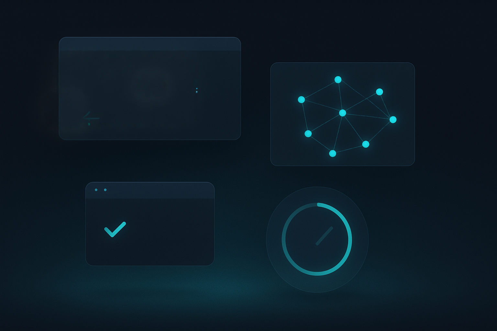
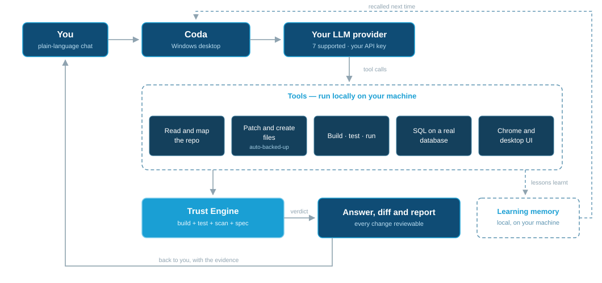
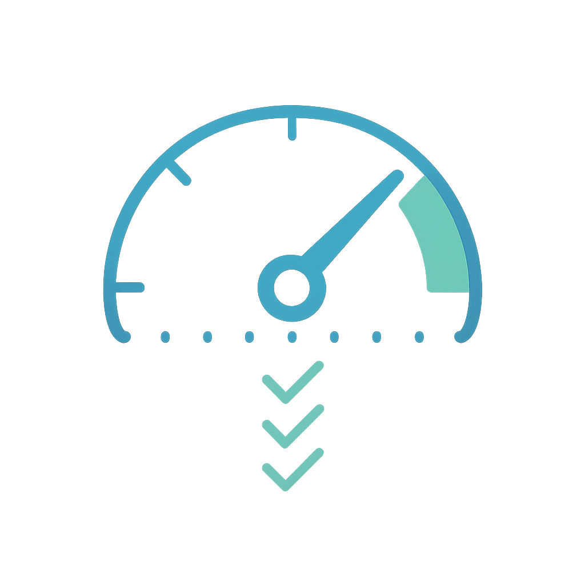

<h1 align="center">Codayak</h1>

<strong>The AI coding workbench that writes your code, builds it, tests it — and proves it works before you release it.</strong>

  
  
  
  

  

**Codayak** — **C**ode **O**rchestration & **D**evelopment **A**ssistant: **Y**our **A**utomation **K**it — is a Windows desktop application.

Point it at a repository, talk to it in plain language, and it reads, writes, compiles, tests and verifies your code through whichever LLM you choose, on your own API key.

  

## Download and install

1. **[Download the latest release](https://github.com/Techniche-Labs/codayak-releases/releases/latest)** — grab `Codayak_Setup_x.y.z.exe` from the Assets list and run it. The installer and application are digitally signed by **TECHNICHE LABS PTY. LTD.**
2. **Requirements** — 64-bit Windows 10 (1809) or later / Windows 11. The installer checks for the [.NET 8 Desktop Runtime](https://dotnet.microsoft.com/en-us/download/dotnet/8.0) and the Microsoft Edge WebView2 Runtime and directs you to them if missing.
3. **Bring your own key** — you'll need an API key for at least one supported LLM provider (Anthropic, OpenAI, xAI, Google, MiniMax, Moonshot or Zhipu).
4. **Upgrading?** Just run the new installer over the top — settings, sessions and memories are preserved.

---

**Contents** — [What it actually does](#what-it-actually-does) · [How a request flows](#how-a-request-flows) · [Why it's different](#why-its-different) · [Getting started](#getting-started) · [Feature reference](#feature-reference) · [Safety and privacy](#safety-and-privacy) · [Licence](#licence)

**Feature deep dives** — [The Trust Engine](#the-trust-engine) · [Whole-repo intelligence](#whole-repo-intelligence) · [Existing code and documents](#working-with-your-existing-code-and-documents) · [The multi-file Coordinator](#the-multi-file-coordinator) · [The research panel](#the-research-panel) · [The tool suite](#the-tool-suite) · [Diffs and rollback](#see-and-reverse-every-change) · [Learning memory](#learning-memory) · [Team Mode](#team-mode) · [Web search](#web-search) · [Image generation](#image-generation) · [Video generation and analysis](#video-generation-and-analysis) · [Speech and Conversation Mode](#speech-and-conversation-mode) · [Meeting Assistant](#meeting-assistant) · [Everything else](#everything-else)

---



---

## What it actually does

| | |
|---|---|
| 🧠 **Reads your whole repo** | A full source-code map — every project, type, member and dependency edge — plus dependency-aware retrieval that pulls coherent slices for cross-cutting work. |
| ✍️ **Writes and patches code** | Surgical find/replace, line-range and between-marker edits. Every write is backed up first and shown in a side-by-side diff. |
| 🔨 **Compiles and tests it** | Build, run tests, run the app, scaffold test projects, drive the `dotnet` CLI — so it fixes what it broke instead of handing you a guess. |
| 🏗️ **Builds whole features** | Ask for something that needs six or more new files and the Coordinator plans the manifest, generates the files in dependency order across independent worker sessions, retries what fails, and can resume an interrupted build. |
| 🗄️ **Runs real SQL** | Executes against SQL Server, PostgreSQL, MySQL/MariaDB, SQLite or Oracle to query, inspect and test the database code it just wrote. |
| 🌐 **Drives a real browser** | Opens actual Chrome, snapshots the page, clicks and types through the flow to verify the UI it changed. |
| 🖥️ **Drives Windows apps** | Attaches to a desktop app via UI Automation and exercises the controls it just built. |
| 🔍 **Reviews pull requests** | Line-by-line review on Azure DevOps and GitHub under *your team's* rules — comment-only unless you explicitly ask it to vote. |
| ✅ **Verifies its own work** | The Trust Engine builds, tests, security-scans and spec-checks the output, then reports a confidence score with per-checker evidence. |
| 📚 **Learns from its failures** | Distils durable lessons into a local memory and surfaces the relevant one before you hit the same wall twice. |
| 🎨 **Makes pictures, video and speech** | Four image providers with reference-image editing, text-to-video, video analysis, and TTS/STT across five speech providers. |
| 🧭 **Runs a research panel** | Fans one question across up to 10 worker LLMs with different analytical framings, then hands every perspective back to be judged. |
| 🔌 **Speaks to seven providers** | Anthropic, OpenAI, xAI, Google, MiniMax, Moonshot, Zhipu — your keys, your models, switchable from the toolbar. |

---

## How a request flows

Your message goes to the model you chose; the model calls tools that run **on your machine**; the Trust Engine checks the result; the verdict and the diff come back to you.

  

---

## Why it's different

**It verifies instead of hoping.** Most assistants generate plausible code and hand it over. Codayak can build it, test it, scan it and spec-check it, then give you a trust band and the evidence behind it.

**It remembers between sessions.** Lessons from what broke *and* what fixed it are stored locally and surfaced on future turns — you explain a convention once, not every session.

**It sees the whole codebase.** A tiered repo map plus dependency-aware retrieval means it changes a thing consistently everywhere, not just in the file in front of it.

**Nothing changes without a trail.** Auto-backup before every write, a side-by-side diff, and one-command rollback. The **Write to Repo** switch is off until you turn it on.

---

## Getting started

Everything you need to set up — adding an LLM key, wiring up web search, and the options worth switching on from day one — lives in the User Guide's **[Get running fast](USER_GUIDE.md#get-running-fast)** walkthrough. Codayak also summarises those steps in the chat window on first start.

Help ships inside the app: the **❓** icon opens the README, the full user guide and the licence at any time.

📘 Full reference: **[USER_GUIDE.md](USER_GUIDE.md)** · 📄 Licence: **[EULA.md](EULA.md)**

---

## Feature reference

### The Trust Engine

Verify before you trust — the layer that runs after generation and before you rely on the result.

- **A real verdict, not a vibe** — trust band (High / Moderate / Low), a confidence score, per-checker evidence and concrete recommendations.
- **What it checks** — for code: build → test → security scan → spec-compliance. For any artefact: a contradiction check against your stored lessons.
- **You control the spend** — opt-in self-election, with hard per-verification and per-session token budgets and Light / Balanced / Deep depth.
- **Tunable eagerness** — from "only when I ask" through to "check almost every change".
- **Audit trail** — every report is written to `.coda/verification/`.

### Whole-repo intelligence

- **Full source-code map** injected into the model's context — projects, types, members and dependency edges.
- **Skeleton fallback** when the map would eat too much of the context window; the model then pulls individual type details on demand (~2 KB per type instead of whole files).
- **Working sets** — describe the job and Codayak returns a ranked bundle of files, each with the reason it was included.

### Working with your existing code and documents

**Attachments — drop anything in.**

- **Drag and drop** files straight onto the message box, or use the attach buttons for **files** or a whole **directory** (recursively scanned for readable text and source files, up to 10 MB each).
- **Paste an image from the clipboard** — a screenshot or copied picture is saved as a PNG and attached. Pasting files you copied in Explorer attaches them too; ordinary text paste is unaffected.
- **It reads the formats you actually have** — PDF, DOCX, XLSX, images and source files.
- **Word work, end to end** — attach several `.docx` files and ask Codayak to summarise, revise or merge them, then have it write the result out as a new `.docx`. Supply a `.dotx`/`.docx` template and the output inherits its styles, headers and footers, and page setup. Attachment reading is text-only, so the sources' own tables and images don't carry across — the template supplies the look.
- Attachments show as a chip on your message and stay in the transcript afterwards.

**Reference repositories, directories and wikis** — read-only context you attach in the system-prompt area:

| What you attach | What it gives the model |
|---|---|
| **Reference repository** | Another repo's source-code map — always skeleton form — as pattern reference: *"build it the way we did it over there."* |
| **Reference directory** | Any folder becomes a browsable read-only root: its files come in as context **and** the read tools (source files, codebase search, directory listing, document reads) reach into it on demand via a `[Name]` path prefix. No map is built — it's a searchable, listable tree. |
| **Reference wiki** | An Azure DevOps or GitHub wiki page tree — titles, paths and sections, enumerated once via the platform API and cached — so the model knows what documentation exists and can fetch pages by path. |

**None of them can ever be written to.** Every mutation tool is bounded to the working repo; reference roots are read-only by construction.

### The multi-file Coordinator

For a build of roughly **six or more new files**, Codayak stops writing them one at a time and runs the Coordinator instead.

- **It plans first** — a file manifest (name, type, path, purpose, dependencies) before any code is written.
- **It generates in dependency order** across independent worker sessions, so each file is written knowing the signatures of the ones it depends on. Workers run on the [Worker LLM](#worker-llm), so you can put them on a cheaper tier than chat.
- **It retries failures** instead of leaving a hole in the build.
- **It can verify each phase** — tick **Settings → Trust Engine → Verify Coordinator phases automatically** and the Trust Engine runs over the phase's output as it finishes.
- **A large build splits into sequential phases**, with a cumulative manifest at `{repo}/.coda/task_manifest.json` — per-phase confidence, band and summary, open issues, and a recovery audit trail.
- **An interrupted build resumes.** Load the manifest and resume: failed and pending files are retried, finished ones are left alone.
- **Where the files land** — straight into the repository when **Write to Repo** is on (backed up and diffable like any other write); otherwise into a timestamped session folder under `MyDocuments/Codayak/Documents/`, so you can ask for a large build without a repo loaded.

### The research panel

One question, answered ten different ways on purpose — because the failure mode of a single line of reasoning is latching onto the first plausible-but-wrong path.

- **It fans one question across up to 10 independent worker LLMs** (0–10, default 6; `0` switches the tool off entirely), each given a **different analytical framing**: the simplest solution, failure modes, first principles, an adjacent-field expert, the steelmanned opposite, the pragmatist on a deadline, long-term maintainability, evidence-vs-unknowns, the user's lens, and a hybrid-seeking synthesiser. Temperatures are spread across the cohort from conservative (0.2) to exploratory (1.0).
- **Varying the *framing* is the point** — a temperature spread alone re-rolls the same argument, whereas making one worker hunt for failure modes while another argues the opposite case is what actually widens the search of the problem space.
- **Each worker can research its own angle.** The cohort gets the read-only tools — source files, codebase search, documents, web search — under the same toggles and repo read-gate as your main session, so a perspective can be evidenced rather than recalled.
- **It deliberately does not pick a winner.** Every labelled perspective comes back to the **main chat model** — the only participant with the full conversation context — to compare where the angles agree and conflict, discard the weak arguments, and recommend the best next step or combination, citing which angles it drew on. Workers that fail or time out are reported, not silently dropped. Nothing is written to disk: the output is a deliberation brief, not an artefact.
- **When it runs** — on an explicit request to research or compare approaches, on a request to design an app or draft a spec/requirements/architecture document, and otherwise under a four-level self-election dial for unprompted use: **User invoked** (never on its own), **Conservative** *(the default — only when genuinely stuck)*, **Standard** (also before consequential or hard-to-reverse decisions) and **Liberal** (also whenever a decision has more than one plausible approach). The two explicit-request paths always work regardless of the dial.
- **It runs on the [Worker LLM](#worker-llm)**, so the whole cohort can be pointed at a cheaper or faster tier than your chat model, and **live progress streams per perspective** as each worker lands.
- **Be honest about the cost** — a panel run costs many times the tokens of a normal answer. That is exactly why unprompted use defaults to Conservative and is reserved for genuine impasses and high-stakes forks rather than every hard question.

All of it is configured in **Settings → Tools**, in the *Research Panel* box at the top of the tab.

### The tool suite

Around 50 tools — over 80 callable endpoints when everything is enabled, counting the Azure DevOps and GitHub families and the conditional Team Mode peer tools — each category individually toggleable in **Settings → Tools**.

| Category | What's in it |
|---|---|
| **Read** | Source files, bounded line ranges, codebase search, type details, working sets, directory listings — across the active repo, reference repos and attached directories. |
| **Modify** | Patch, create, move, copy, delete — files and directories. Write-gated, path-bounded, always backed up first. |
| **Build & run** | Build, test, run, scaffold test projects, add to solution, arbitrary `dotnet` commands. |
| **Database** | One `ExecuteSql` tool across five engines, with bundled ADO.NET drivers. |
| **UI testing** | Real Chrome (open/snapshot/click/type/wait) and Windows desktop apps via UI Automation. Credentials pass as placeholders, never plain text. |
| **Content & web** | Documents, Word files, Mermaid diagrams, image and video generation, video analysis, web search, multi-file builds, the research panel. |
| **Codayak itself** | `ReadHelpDoc` — the README, user guide and licence, so the assistant can answer "how do I…" questions about Codayak. |

### See and reverse every change

- **Side-by-side diff** — synchronised scrolling, change-to-change navigation, ignore-whitespace, minimap. Non-modal, so you keep chatting.
- **Auto-backup** to `.coda/backups/` before every write; restore any version with one command.
- **Configurable retention** — backups swept after a set window (7 days by default).
- **Cancel really stops it** — cancelling ends the streamed text *and* the tool that is mid-flight: a repo search, a network call, a `dotnet` build/test/run (the child process is killed), or a Coordinator build. The cancelled tool says so in the transcript.
- **A cancelled write is never half a file** — you are left with either the original file or a completed write, and a cancelled directory copy leaves only complete files.

### Learning memory

Cross-session learning that actually persists. Switch it on at **Settings → Memory → Enable Learning Memory**.

**Three ways a memory gets created**

| Route | How it happens |
|---|---|
| **Codayak notices** | Repeated tool failures or successive build errors trigger a reflection pass automatically — it works out the lesson without being asked. |
| **You say so in chat** | Start a message with *"remember this"*, *"make a note that…"*, *"that's worth remembering"*. Codayak distils your text into a structured memory, saves it, and confirms the title and resolution. The intent match is deliberately conservative, so be explicit. |
| **You write a description** | **Settings → Memory → Create memory from description** — a plain-English box for composing a longer lesson at leisure; Codayak distils it into the same structured note. |

**How it behaves**

- **On-device embedding** — text is embedded locally with the BGE-small-en-v1.5 ONNX model. **No memory text leaves your machine.**
- **Hybrid retrieval, injected proactively** — before every send, vector *and* lexical (FTS) search are fused by reciprocal rank with confidence weighting; matches above your relevance floor are injected as a `<learned_lessons>` block. One arm keys on the conversation topic, the other on what the assistant is *about to do*.
- **Confidence that tracks reality** — a clean turn increments `TimesValidated`, a rollback increments `TimesContradicted`, and confidence is Laplace-smoothed from the two. A utility boost favours proven, recently-used lessons; a ~62-day recency half-life lets stale ones fade.
- **De-duplication and evolution** — near-duplicates merge into the existing row on capture, and an asynchronous **merge / supersede / link** pass (on the Worker LLM) reconciles each new memory against similar existing ones.
- **The Memory tab** — a searchable grid showing the *same* fused score the injector uses, so you can predict what the model will actually see. Edit any memory's title, problem, symptom, resolution and tags; **export** to JSON (sensitive context scrubbed by default, embeddings always stripped) and **import** a colleague's file, merging by semantic similarity; **self-test** runs embedder → repository → retrieval → injection end to end and reports per-step health.

### Team Mode

Other Codayak instances — on this machine or across the LAN — become tools of your chat model.

- **Every joiner is a callable tool.** Share an invite code; each peer announces its provider, model, context window, enabled tools and repo.
- **Delegate asynchronously** — hand a task to the right peer (with an optional role prompt), keep working, collect the result later.
- **Peers really work** — a delegated task runs a full tool loop on the peer: read, patch, build, test.
- **Autonomous mode** — give the leader a goal and it plans the waves, assigns roles, runs peer cross-review and reconciles the result.
- **Multi-repo development** — the leader works the main app's repository while a peer holds a repo it depends on (say, the API the app calls) and implements that half there, with its own source map, builds and tests.
- **Encrypted** — Ed25519 identity, X25519 key exchange, AES-256-GCM messages, TLS with certificate pinning, LAN discovery via mDNS.

### Web search

**It does not work without credentials.** `SearchInternet` is Google Custom Search: if the API key or the search engine ID is missing, the tool returns *"Google Search API key or Search Engine ID is not configured"* and no search happens. (A direct URL you hand it is still fetched — that path doesn't call the Google API.)

- **What you need** — a Google Custom Search JSON API key **and** a Custom Search Engine ID.
- **Where it goes** — **Settings → Web Search**, alongside optional proxy settings, the parallel-page count and the off-screen browser toggle.
- **Why it's near-essential** — it is the model's only window onto anything past its training cut-off.

Once configured:

- **Real Chrome renders each result page**, so most anti-bot checks pass and you get the actual content rather than a snippet.
- **Parallel fetches** with off-screen rendering, proxy support, and relevance-trimmed output to keep the context bill down.
- **Image search** for visual-identification work — Codayak attaches downscaled photos for the model to inspect when appearance genuinely matters.

### Image generation

| Provider | Generate | Edit a reference image |
|---|---|---|
| **OpenAI** — gpt-image family | ✅ | ✅ (`gpt-image-1` / `dall-e-2`; `dall-e-3` generates only) |
| **Stability AI** — Core, Ultra, SD3, SDXL | ✅ | ✅ |
| **xAI** — Grok Imagine | ✅ | ✗ |
| **Google** — Imagen | ✅ | ✗ |

- **"Let the Agent Choose" is the default** — for both the provider and the model. Codayak picks a suitable one per request from the providers you hold keys for, including choosing an **edit-capable** model when you ask for an existing image to be changed. The tool description carries a live, key-verified list, so the choice is made from real options. Pin a provider or model in **Settings → Visual Models** to override it.
- **Text-to-image and image-to-image** — pass a reference image (an attachment, or any image in the repo) and the output follows its composition while applying your prompt. Your original file is never modified.
- **`strength` controls how far an edit may depart** from the original (Stability): `0.2`–`0.4` for a faithful touch-up, `0.6`–`0.7` (default `0.65`) for a reinterpretation that keeps the composition, `0.8`+ to treat the reference as loose inspiration.
- **The model sees its own output** — the generated image is attached to the next turn, so the assistant can judge whether it matched the request and regenerate with a corrected prompt, a different strength, or the other provider.
- **It is not an upscaler** — "make it clearer" produces a re-imagined picture at the provider's resolution, not a sharpened copy.
- **Where files land** — `{repo}/Documents/Images/` with a repo loaded and Write to Repo on, otherwise `MyDocuments/Codayak/Documents/session_{timestamp}/Images/`. Output is auto-registered with `.codaignore` so it doesn't pollute later searches.
- **Keys** — Stability has its own key on the Visual Models tab; OpenAI, xAI and Google reuse their key from **Settings → LLM Providers**.

### Video generation and analysis

**Generate — honestly, the limits matter:**

- **Text-to-video only.** No provider currently offers video editing or animating a supplied image, and the tool says so plainly rather than substituting something else.
- **xAI (Grok Imagine)** is the only wired video endpoint today.
- **Roughly 30–90 seconds** per clip, saved as an **`.mp4`**.

**Analyse — `AnalyseVideo`:** point Codayak at a video file and it watches it and returns a **timestamped written description** to reason about — shots, subjects, dialogue, events, quality, cut points, or an answer to a specific question you pose. It runs on **Google Gemini regardless of which chat model you're using**, so it works from any provider. Billed per second of footage, so one well-aimed question beats several narrow ones.

### Speech and Conversation Mode

Five providers, each independently configurable in **Settings → Audio Models**:

| Provider | What it gives you |
|---|---|
| **Deepgram** | TTS **and** STT on one key (Aura-2 / Nova-3) — the recommended default and the cheapest way to get both. |
| **ElevenLabs** | TTS and STT; the highest-quality voices. |
| **OpenAI** | TTS plus batch STT. |
| **AssemblyAI** | STT with real-time speaker separation — well suited to the Meeting Assistant. |
| **Azure** | TTS with style and pitch controls, plus STT. |

- **Two independent toggles on the chat toolbar** — 🔊 reads the assistant's replies aloud; 🎙 dictates your message into the input box as you speak. Use either on its own.
- **Spoken replies stay speech-friendly automatically.** With read-aloud on, Codayak injects a speech prompt so the reply comes back as natural spoken English — no markdown, no code blocks. Length is set by **Settings → General → Speech verbosity** (Concise by default), and code or file contents are only read out at **Detailed**; otherwise they're described in plain words.
- **Conversation Mode — hands-free.** Turn **both** toggles on and Codayak runs the loop: you speak, the transcript accumulates, and after a configurable silence (default **800 ms**) it auto-sends. The reply is spoken back. Saying **"stop"**, **"wait"**, **"cancel"** or **"hang on"** barges in immediately — TTS halts, the stream cancels, and Codayak goes back to listening.
- **Tunable** — silence window, barge-in minimum length, filler-word filter, interrupt-word list, confidence floor and auto-send minimum length all live under **Settings → Audio Models → Conversation Mode**.

### Meeting Assistant

The 🎤 **Meeting** section is built to sit in the background during a call: it captures **your microphone and the system-loopback audio** (everyone else on the call), transcribes each utterance, and distils the conversation into a curated Insights feed rather than a second transcript.

- **Live Transcript** — the verbatim record, one speaker-prefixed line per utterance, from automatic diarisation. **Rename speaker** relabels every past line for that voice, and giving two labels the same name merges them back into one person. After the meeting, **right-click a turn → Replay this block** to hear the audio before deciding who said it — the pick-list offers every attendee the meeting client saw, and you can always type a name instead.
- **Live Insights** — a colour-coded, deduplicated feed distilled every ~45 seconds: **decisions**, **action items**, **open questions**, **risks/blockers**, **claims to verify** and **key points**, each with an owner (where known) and a timestamp.
- **Meeting-type lens** — **General**, **Team Standup**, **Interview**, **Sales / Client Call**, **One-on-One** or **Brainstorm** changes what the Insights feed watches for and how the final summary is shaped. Changeable mid-meeting.
- **Accuracy levers** — fill in **Domain terms** before you start to bias the recogniser toward your jargon. On Microsoft Teams the participant roster and active speaker are read from the call itself — including **your own tile**, which names your microphone channel automatically and excludes anything the mic picks up while you're muted in the meeting. Every speaker you rename becomes ground truth for the summary's attribution.
- **End-of-meeting summary** — **📄 Generate Summary** produces key decisions, action items grouped per person and unresolved questions, in a structure suited to the meeting type; copy, email, print or save it as Markdown. The summary is **read-only over your transcript**: it is generated from the final transcript exactly as attributed (the provider's diarisation plus your corrections), with the original live transcript, the meeting roster and your domain terms supplied as context — it never rewrites or re-attributes a line.
- **Optional after-meeting reprocessing** — with **Record for batch diarisation** on (the default, in **Settings → Audio Models**), clicking Stop re-transcribes the whole recording in one pass for a markedly cleaner, better-attributed transcript, and lets you **replay any turn's audio** while fixing speaker names. The recording never leaves your machine and is deleted when the next meeting starts — or turn the option off and nothing is recorded at all: the live transcript is final.
- **Insights are optional** — untick **Live insights** for a cheaper transcript-only session; the summary still works.

Any configured STT provider works. Deepgram, AssemblyAI and Azure give real-time speaker separation; OpenAI/Whisper transcribes but can't separate speakers.

### Everything else

| | |
|---|---|
| **Skills** | Named instruction documents — "how to work on app X" — written once, loaded automatically when the task matches. Only each skill's name and description costs context until it fires. |
| **Coding style & PR rules** | Point Codayak at your codebase and it extracts your conventions into a style guide and review rule set, then applies them to every write and every PR review. |
| **DevOps** | Azure DevOps and GitHub — work items, wikis, pull requests. Multiple connections per platform, one active. |
| **Docs & diagrams** | Mermaid diagrams, Markdown and Word output; reads attached `.docx` and can style from a template. |
| **Worker LLM** | One shared setting for every background call — Coordinator, [research panel](#the-research-panel), memory evolution, rule generation — so you can run them on a cheaper tier than chat. |
| **Model catalogue** | **Fetch Latest** pulls each provider's current model list, classifies every model by modality, live-checks new chat models against the generate endpoint, and presents everything in a review dialog before importing. **Verify Endpoints** re-checks what's already there. New models become usable as soon as the provider ships them — no waiting for a Codayak update. |
| **Session continuity** | Auto-save as you work; **Restore Session** distils past conversations into a compact summary instead of replaying raw transcripts; save or print any conversation (Markdown, plain text or HTML). |
| **Comfort** | Dark and light themes, adjustable font size, **Ctrl+F** find-in-conversation, and **Ctrl+±** / **Ctrl+0** zoom in the transcript. |
| **Keyboard shortcuts** | Every shortcut is customisable in **Settings → Hot Keys** — including swapping **Enter** and **Ctrl+Enter** for send versus new line. |

---

## Safety and privacy

- **Write to Repo is a switch you control.** Nothing is modified while it's off.
- **Every mutation is backed up and reversible**, and bounded to the working repo.
- **Codayak asks before touching a database** on its own initiative, showing the target, the operation and the exact SQL.
- **Memory stays local.** Lessons live in a SQLite file on your machine and are embedded on-device — no memory text is sent anywhere.
- **Your code stays on your machine.** It runs client-side with no account and no server. Network egress is the LLM API call you configured, plus any optional integration you switch on.
- **The only thing Codayak itself sends** is a once-a-day update check. The single request carries exactly two values — a random install identifier generated at install time and the version number — and returns the latest released version so Codayak can tell you when an update is available. It fails silently when offline. Your files, prompts, conversations, keys and machine details are never transmitted.

---

## Licence

Free for **personal and commercial** use. You may not redistribute, modify or reverse-engineer it. Provided "as is", with no warranty.

Full terms: **[EULA.md](EULA.md)** · © Techniche Labs Pty Ltd, Australia — [technichelabs.com.au](https://www.technichelabs.com.au/)
